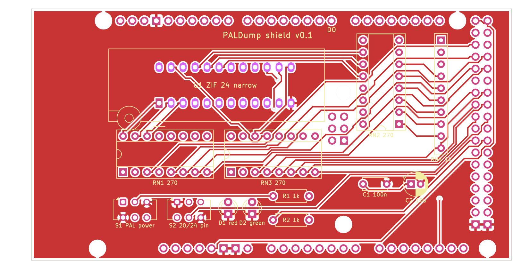

# PALDump – fork with a Mega 2560 shield

This is a fork of [rpocc/PALDump](https://github.com/rpocc/PALDump) by Dmitry Shtatnov. It adds a plug-on PCB (shield) for
the Arduino Mega 2560 with one 24-pin ZIF socket, so PALs can be dumped without a breadboard. The original description
follows below, unchanged.

## Shield

- **One 24-pin ZIF socket (0.3").** 24-pin PALs (PAL20L8) fill it. 20-pin PALs (PAL16L8, PAL10L8 and other
  combinatorial 20-pin types) go in **flush with pin 1** (lever side), the four contacts at the far end stay empty.
  Pin 24 is VCC for both sizes.
- **S2 "20/24".** Contact 10 is GND for a 20-pin PAL and an input for a 24-pin PAL; S2 switches it. Its second pole
  tells the firmware the type (D40), so no recompiling between PAL16L8 and PAL20L8.
- **S1 "PAL power".** Off: the socket is unpowered and the Arduino is held in reset, so all pins are high-impedance
  while you change the chip. On: the socket gets 5 V and the dump starts. Red LED = socket powered, green LED = dump
  running (D41).
- **Resistor arrays.** Every socket contact has a 270 Ω series resistor (3× DIP-16 isolated array). Contacts 15–23
  can carry PAL outputs and get a 1 kΩ to the probe line D39 (bussed SIP-10) for the tri-state detection.
- The firmware maps the socket contacts to the three port bytes the analysis works with (`PALDump.h`, port layer),
  so the dump is the same as with the original wiring. `PALDUMP_SHIELD 0` in `PALDump.h` restores the breadboard
  wiring.

| Socket contact | 20-pin PAL (S2 on 20) | 24-pin PAL (S2 on 24) | Arduino Mega |
|---|---|---|---|
| 1–8 | I1–I8 | I0–I7 | D22–D29 (PA0–PA7) |
| 9 | I9 | I8 | D37 (PC0) |
| 10 | GND (via S2) | I9 | D36 (PC1) via S2 |
| 11 | – | I10 | D35 (PC2) |
| 12 | – | GND | GND |
| 13 | – | I13 | D32 (PC5) |
| 14 | – | I11 | D34 (PC3) |
| 15 | I10 (pin 11) | O1 | A8 (PK0) |
| 16–22 | O1, IO2–IO7 (pins 12–18) | IO2–IO7, O8 | A9–A15 (PK1–PK7) |
| 23 | O8 (pin 19) | I12 | D33 (PC4) |
| 24 | VCC (pin 20) | VCC | 5 V via S1 |

Usage: S1 off, S2 to the PAL size, insert the PAL, open the serial monitor (115200 Bd, log to file), S1 on. The
analysis and the truth table run as described below; the green LED goes off when it is done.

Files:

- `hardware/shield/` – KiCad 7 project, schematic PDF/PNG, gerber ZIP, renders, DRC report
- `hardware/generator/` – Python scripts that generate schematic and board (`sh build.sh shield`, then
  `sh outputs.sh shield`; KiCad 7, Freerouting 1.9). The schematic wires are drawn by `router.py`.
- `hardware/lib/` – ZIF symbol with the PAL pin roles; Mega shield footprint from
  [Alarm-Siren/arduino-kicad-library](https://github.com/Alarm-Siren/arduino-kicad-library) (CC BY-SA 4.0)
- `test/sim/` – host build of the firmware against a simulated PAL; checks that shield and original wiring give
  the same dump (`sh test/sim/run.sh`)

Status: **not built yet** – the board and the shield firmware are untested on real hardware; the simulation passes.

### Parts

| Qty | Ref | Part |
|---|---|---|
| 1 | U1 | ZIF socket 24-pin, 0.3" narrow (e.g. 3M Textool 224-5248-00-0602J) |
| 3 | RN1–RN3 | Resistor array 8× 270 Ω isolated, DIP-16 (e.g. Bourns 4116R-1-271) |
| 1 | RN4 | Resistor array 9× 1 kΩ bussed, SIP-10 (e.g. Bourns 4610X-101-102) |
| 2 | S1, S2 | Slide switch DPDT, 2.54 mm (C&K JS202011CQN) |
| 2 | R1, R2 | Resistor 1 kΩ |
| 1 | D1 | LED 3 mm red |
| 1 | D2 | LED 3 mm green |
| 1 | C1 | Capacitor 100 nF |
| 1 | C2 | Electrolytic capacitor 10 µF |
| 1 set | – | Headers for the Mega: 1× 10, 5× 8, 1× 2×18 (male pin headers, or stacking headers) |

## Authors

- **Dmitry Shtatnov** (rpocc) – PALDump firmware and method – https://github.com/rpocc/PALDump
- **Stefan Fambach** (SteFam) – idea and concept of the shield build, review and testing – https://www.fambach.net
- **Claude** (Anthropic AI) – implementation of the shield build (schematic, PCB, firmware port layer and
  documentation), via Claude Code

## AI disclosure

The shield build in this fork is made with AI assistance. Stefan Fambach had the idea, set the concept and reviews
and tests every change; the implementation (schematic, PCB, firmware changes and documentation) is written largely by
Claude (Anthropic) via Claude Code. The original PALDump firmware is the work of Dmitry Shtatnov.

## Licence

- Firmware (`source/`): CC BY-NC-SA 4.0, as the original PALDump (see the header of `PALDump_2560.ino`). The shield
  changes are under the same licence.
- Shield hardware (`hardware/shield/`, `hardware/generator/`, `hardware/lib/paldump.kicad_sym`): CERN-OHL-S-2.0.
- Mega shield footprint/symbol (`hardware/lib/arduino-library*`): CC BY-SA 4.0, Alarm-Siren.

---

# Original README

# PALDump
Combinatorial Programmable Array Logic dumper for Arduino

Features:
 1. Detection of tri-state outputs using the dedicated probe pin.
 2. Analysis of outputs. It reads each output pin and counts occurunces of each state for all 65K/1M of input combinations, detects inputs, outputs, I/O or buffered outputs and builds a list of output functions per physical output and Output Enable.
 3. Analysis of inputs. It tests each input or I/O pin and detects if any change at this input doesn't affect output functions. Then it builds a table of usable inputs.
 4. It generates the optimized truth table (with excluded unused inputs) in Berkeley format and transfers it via Serial port. (USB/UART1 by default)

Requirements:
 1. An Arduino development board. MEGA2560 is recommended. Uno and other ATMEGA328 based boards aren't supported!
 2. 3x complete I/O ports (7..0), which aren't shared with Serial.
 3. 1x additional I/O pin for probe
 4. A breadboard with a set of jumper wires
 5. 25x Dupont/compatible Male-Male wires
 6. 8x thru-hole resistors of 220..270 Ohms
 7. 8x thru-hole resistors or one-to-many resistor array of 1..1.5 KOhm
 8. A terminal program which can save serial communication log to a file. (Arduino IDE 2.0+ doesn't allow exporting or copying of the Serial Monitor output, so PuTTY is recommended)
 9. Installed Espresso Logic Minimizer. (Free)
10. A CPLD development software such as Atmel WinCUPL for generating the .jed files

Usage:
 1. Connect the PLA chip to the Arduino as shown on the schematic (See PALDump.h)
 2. Set the constant PALDump::PALType globalPALType to PAL16L8 or PAL20L8
 3. Recompile and upload the project into Aruino board.
 4. Connect with the Arduino serial port using a terminal program and save the full log to a text file.
 5. Clean the header if needed and feed the file to Espresso using the following command:

    espresso -Dexact -Dmany -o eqntott inputfile.pld > outputfile.pld

 6. Analyze and reformat the output in order to use it for designing your own clone of PLA using CPLD design software of your choice. (Invert boolean functions for outputs, keep for .OE, remove input terms for buffered outputs, which are duplicated in .OE equations, etc)

Precautions:
*  Serial communication at 115200 bps is slow for transferring thousands of text lines. It can take up to 200 seconds for transferring 65K entries and up to 1 hour (!) for 1M entries, so program does it best in advance to exclude unneeded inputs and outputs from the truth table which halfs its size with each excluded input . Analysis of PAL16xx usually takes up to 20 seconds while full analysis of PAL20xx may take 16 times more, but eventually it saves up to 10 times more time. Using faster serial communication is also adviced.
*  It's recommended to read several copies of truth table and compare them using fc or another file compare utility to detect errors. Automatic optional error-correction will be added later, but it's expected to consume more time.
*  This tool isn't designed as a blind push-button solution, although most of hardwork is performed in fully automatic mode along with Espresso. The output still needs evaluation with a certain degree of scepticism and common sense.
   

